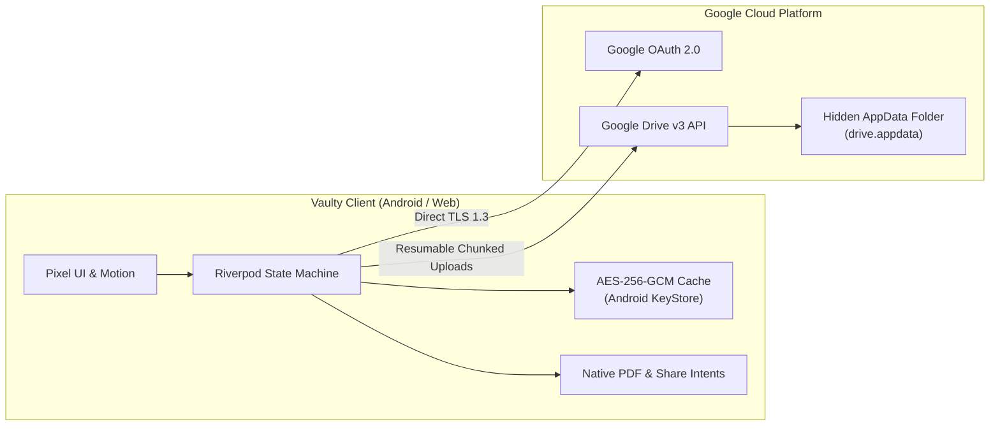

# Vaulty

<p align="center">
  
</p>

<h3 align="center">Your Private, Decentralized Personal Document Vault</h3>

<p align="center">
  A high-security, serverless document organizer and vault for Android and Web. Built with Flutter, inspired by Google Pixel Material 3 aesthetics, and powered directly by your own Google Drive storage.
</p>

<p align="center">
  <a href="https://flutter.dev"></a>
  <a href="https://dart.dev"></a>
  <a href="https://developer.android.com"></a>
  <a href="LICENSE"></a>
  <a href="https://github.com/Byte-Craftsman-Alpha/Document-Organizer/actions"></a>
  <a href="https://teamparadox.in"></a>
</p>

---

## Highlights & Features

- **Zero-Backend Architecture**: Your files never touch any intermediary server. Vaulty communicates directly with Google OAuth 2.0 and Google Drive API v3.
- **Hidden Drive App-Data Storage**: Documents are stored in your hidden Google Drive Application Data folder (`drive.appdata`), completely shielded from accidental deletion or clutter in your main Drive.
- **Hardware-Backed AES-256-GCM Encryption**: Local document caching is encrypted at rest on Android with keys managed directly by the hardware-backed **Android KeyStore**.
- **Biometric App Lock**: Secure app access with your device's native fingerprint scanner, face recognition, or device PIN.
- **Google Pixel UI & Motion**: Crafted with Material 3 tonal palettes, dynamic cards, bouncy spring physics, haptic feedback, 48dp touch targets, and 1.3x text accessibility scaling.
- **Document Expiration & Renewal Engine**: Set renewal dates on legal IDs, insurance policies, or passports. Receive native Android notifications 30 days, 7 days, and on the day of renewal.
- **System Share-Intent Intake**: Share documents directly from WhatsApp, Chrome, or Gmail into Vaulty with batch review and temporary encrypted staging.
- **Native PDF & Multi-Format Previews**: High-performance first-page PDF preview rendering via native Android `PdfRenderer`. Full support for PDF, JPEG, PNG, WebP, GIF, HEIC/HEIF, and DOCX up to 50 MB.
- **Bilingual Localization (English & Formal Hindi)**: 190+ formal Hindi translation keys with strict zero-translation guardrails protecting raw user-entered document data.
- **Data Portability & Emergency Backup**: Export a complete unencrypted ZIP backup containing all your documents and canonical metadata at any time.

---

## Architecture Overview



For an exhaustive technical breakdown, consult the [App Architecture Documentation](docs/APP_ARCHITECTURE.md) and the [Engineering Project Report](docs/PROJECT_REPORT.md).

---

## Project Structure

```
├── .github/
│   └── workflows/
│       ├── build-apk.yml     # Automated CI/CD for building downloadable release APKs
│       └── ci.yml            # Linting, formatting, and automated test suite runner
├── docs/                     # Project architecture, engineering reports, and setup guides
│   ├── APP_ARCHITECTURE.md   # Layer breakdown, cryptographic pipeline, and native bridges
│   └── PROJECT_REPORT.md     # Engineering report, security threat model, and benchmarks
├── vaulty/                   # Primary Flutter cross-platform mobile application
│   ├── android/              # Native Android host, KeyStore bridge, and FileProvider
│   ├── assets/               # Bundled fonts (Public Sans), tokens, and public configs
│   ├── lib/                  # Application source code (Clean Architecture)
│   │   ├── app/              # Bootstrap, router (GoRouter), navigation shell
│   │   ├── core/             # Material 3 themes, abstract art, l10n (hi.dart, en), widgets
│   │   ├── data/             # Encrypted cache, Drive API v3, device services
│   │   ├── domain/           # Models (Document, StorageInfo) and repository contracts
│   │   └── features/         # Home, Documents, Upload, Search, Imports, Settings, Trash
│   └── test/                 # Comprehensive unit, widget, and l10n test suites (58 tests)
├── vaulty-web-preview/       # Standalone static web preview environment
├── CONTRIBUTING.md           # Contribution workflow, coding standards, and PR guidelines
├── CODE_OF_CONDUCT.md        # Contributor Covenant Code of Conduct v2.1
├── LICENSE                   # MIT Open Source License
├── PRIVACY_POLICY.md         # Zero-backend privacy policy and Google Limited Use disclosure
├── README.md                 # Project README and quickstart guide
├── SECURITY.md               # Vulnerability reporting and security architecture
└── TERMS_AND_CONDITIONS.md   # Legal terms of use and warranty disclaimers
```

---

## Getting Started

### Prerequisites

- [Flutter SDK](https://docs.flutter.dev/get-started/install) (`^3.27.0`)
- [Android SDK](https://developer.android.com/studio) (API 35 target, API 26 minimum)
- [Java Development Kit (JDK 17)](https://adoptium.net/)
- Physical Android device or Emulator with Google Play Services

### Installation & Run

1. **Clone the Repository:**
   ```bash
   git clone https://github.com/Byte-Craftsman-Alpha/Document-Organizer.git
   cd Document-Organizer/vaulty
   ```

2. **Fetch Dependencies:**
   ```bash
   flutter pub get
   ```

3. **Run Code Analysis & Test Suites:**
   ```bash
   flutter analyze
   flutter test
   ```

4. **Launch Application:**
   ```bash
   # Run with real Google Drive authentication
   flutter run

   # Or run with the standalone mock/fixture gallery (no Google credentials needed)
   flutter run -t lib/main_demo.dart
   ```

---

## Building the Release APK

To compile an optimized, production-ready release APK for Android:

```bash
cd vaulty
flutter build apk --release
```

The resulting binary will be located at:
`vaulty/build/app/outputs/flutter-apk/app-release.apk`

### Automated Builds via GitHub Actions

Every push and release tag triggers the automated `.github/workflows/build-apk.yml` workflow, which runs static analysis, executes all 58 automated tests, and generates a downloadable APK with SHA256 verification checksums attached to the GitHub Actions run or release.

---

## Authors & Collaborators

### Lead Developer
**Aditya Chaudhari**
- Website: [aditya.teamparadox.in](https://aditya.teamparadox.in)
- Email: [aditya@teamparadox.in](mailto:aditya@teamparadox.in)

### Collaboration & Contributions
**Team Paradox**
- Website: [teamparadox.in](https://teamparadox.in)

---

## License

This project is licensed under the **MIT License** — see the [LICENSE](LICENSE) file for details.
