# Vaulty

<p align="center">
  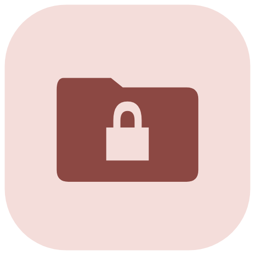
</p>

<h3 align="center">Your Private, Decentralized Personal Document Vault</h3>

<p align="center">
  A high-security, serverless document organizer and vault for Android and Web. Built with Flutter, inspired by Google Pixel Material 3 aesthetics, and powered directly by your own Google Drive storage with hardware-backed encryption.
</p>

<p align="center">
  <a href="https://flutter.dev"></a>
  <a href="https://dart.dev"></a>
  <a href="https://developer.android.com"></a>
  <a href="LICENSE"></a>
  <a href="PRIVACY_POLICY.md"></a>
  <a href="TERMS_AND_CONDITIONS.md"></a>
  <a href="https://github.com/Byte-Craftsman-Alpha/Document-Organizer/actions"></a>
  <a href="https://teamparadox.in"></a>
</p>

<p align="center">
  <a href="#highlights--features">Features</a> &bull;
  <a href="#live-screenshots">Screenshots</a> &bull;
  <a href="docs/APP_ARCHITECTURE.md">Architecture</a> &bull;
  <a href="PRIVACY_POLICY.md">Privacy Policy</a> &bull;
  <a href="TERMS_AND_CONDITIONS.md">Terms &amp; Conditions</a> &bull;
  <a href="LICENSE">License</a>
</p>

---

## Live Screenshots

> [!NOTE]
> All captured screen snippets are sourced directly from real physical Android hardware testing (Redmi Note 8, 1080 &times; 2340 px native resolution) running production release builds.

| Authentication & Offline Vault | Home Dashboard (Light) | Live Drive Quota (Dark) |
| :---: | :---: | :---: |
| 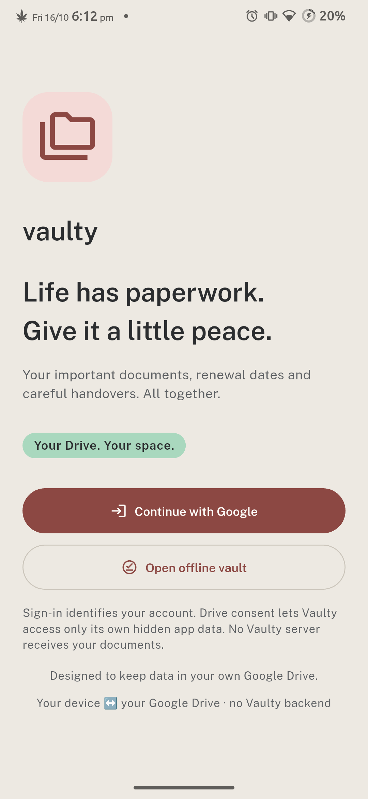 | 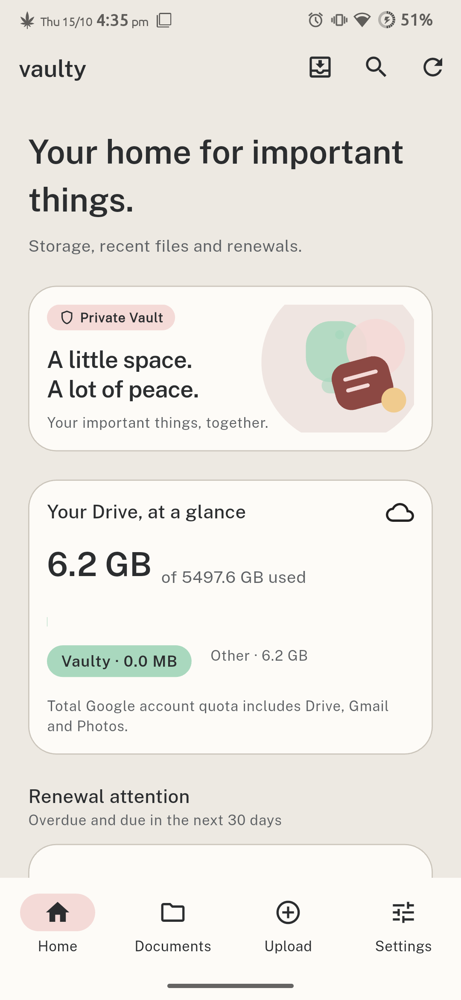 | 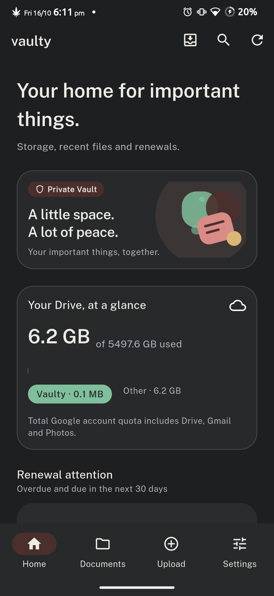 |
| *Zero-backend Google OAuth & Offline Access* | *Pixel Material 3 UI & Renewal Attention* | *Real Google Drive Quota Breakdown* |

| Document Explorer | Document Inspection & Renewal | Multi-Source Upload Sheet |
| :---: | :---: | :---: |
| 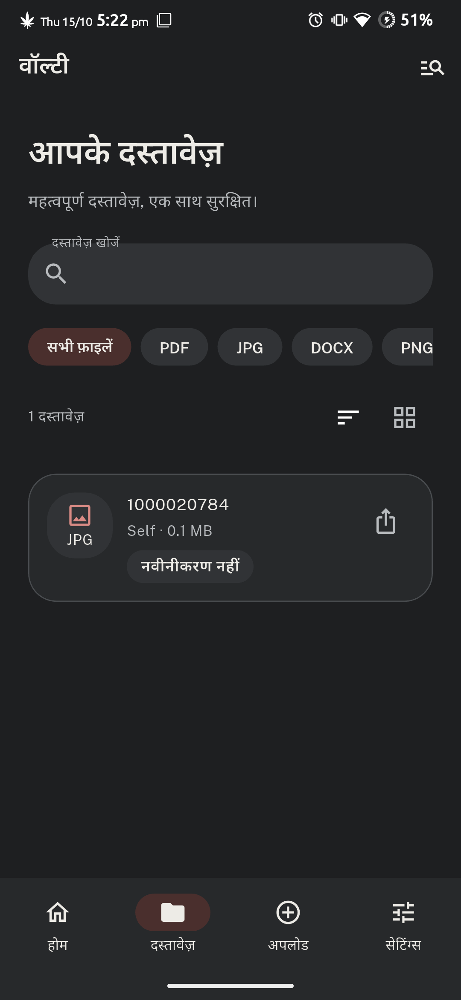 | 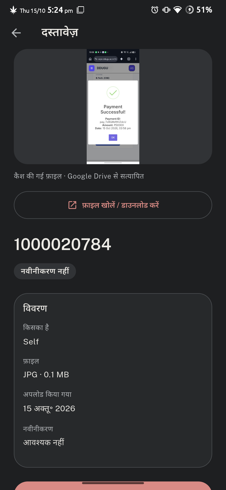 | 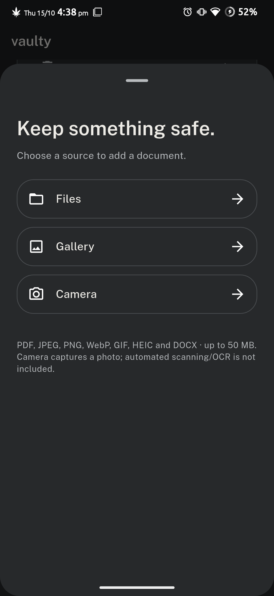 |
| *Multi-format filtering (PDF, JPG, DOCX)* | *Drive verified status & renewal tracker* | *Camera, Gallery, Files & Share-Intent* |

| Security & Biometrics | Encrypted Cache & Quota | Safe Trash Recovery |
| :---: | :---: | :---: |
| 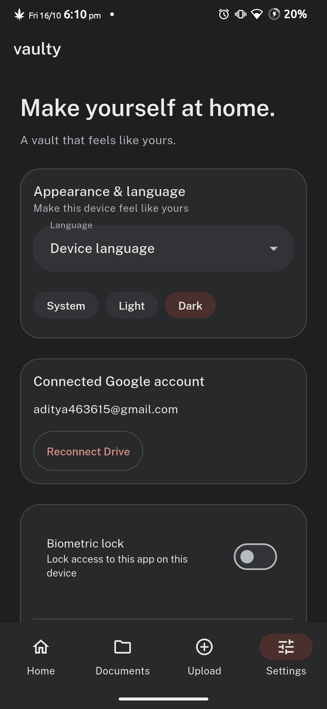 | 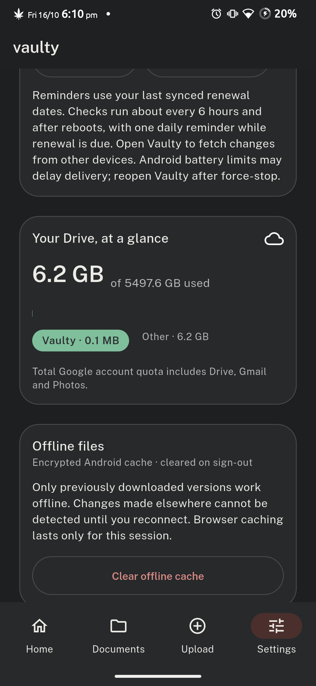 | 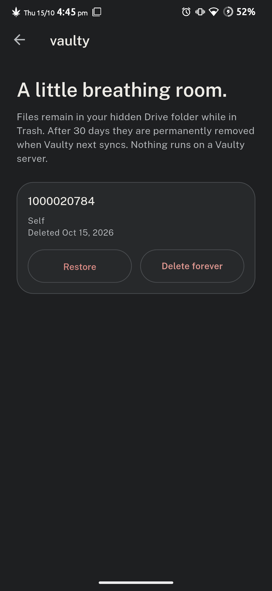 |
| *Fingerprint / Face lock & Drive state* | *Android KeyStore AES-256 cache (256 MB)* | *30-day soft-delete retention window* |

---

## Highlights & Features

- **Zero-Backend Architecture**: Your files never touch any middleman server. Vaulty communicates directly from your device to Google OAuth 2.0 and Google Drive API v3 via TLS 1.3.
- **Hidden Drive AppData Folder**: Files live inside Google Drive's dedicated Application Data folder (`drive.appdata`), completely shielded from accidental deletion, public sharing, or clutter in your main Google Drive.
- **Hardware-Backed AES-256-GCM Encryption**: Local document caching is encrypted at rest using keys generated and isolated inside the device's hardware **Android KeyStore** (StrongBox / TEE).
- **Biometric App Lock**: Secure app access with native fingerprint scanning, facial recognition, or device lock PIN.
- **Google Pixel Material 3 Aesthetics**: Crafted with warm terracotta and stone tonal palettes, bouncy spring physics, haptic feedback, 48dp touch targets, and full 1.3x text accessibility scaling.
- **Document Expiration & Renewal Alerts**: Assign renewal dates to legal IDs, vehicle insurance, or passports. Receive native notifications 30 days before, 7 days before, and on the day of renewal.
- **System Share-Intent Intake**: Share documents directly from WhatsApp, Chrome, or Gmail into Vaulty with batch review and temporary encrypted staging.
- **Native PDF & Multi-Format Previews**: High-performance first-page PDF preview rendering via Android `PdfRenderer`. Full support for PDF, JPEG, PNG, WebP, GIF, HEIC/HEIF, and DOCX up to 50 MB.
- **Safe 30-Day Trash & Recovery**: Soft-delete allows 30-day file restoration. Purges are atomic and guarded against accidental data loss.
- **Bilingual Localization (English & Formal Hindi)**: 190+ formal Hindi translation keys with strict zero-translation guardrails protecting raw user metadata.
- **Zero Lock-In Portability**: Export a complete unencrypted ZIP backup containing all original documents and canonical JSON manifests at any time.

---

## Architectural Dataflow

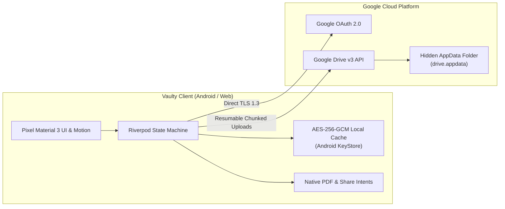

For an exhaustive technical breakdown, consult the [App Architecture Documentation](docs/APP_ARCHITECTURE.md) and the [Engineering Project Report](docs/PROJECT_REPORT.md).

---

## In-Depth Competitor Comparison

| Dimension | **Vaulty** | **DigiLocker** | **1Password** | **Bitwarden** | **Google Drive / Dropbox** | **CamScanner** |
| :--- | :---: | :---: | :---: | :---: | :---: | :---: |
| **Backend Dependency** | **Zero (Serverless)** | Government Central Server | Proprietary Cloud | Central Cloud Server | Multi-Tenant Cloud | Chinese Cloud Servers |
| **Data Ownership & Storage** | **User's Private Google Drive (`drive.appdata`)** | Government Database | 1Password Hosted Vault | Bitwarden Vault Server | Generic Public Cloud Storage | Proprietary Cloud Storage |
| **Hardware-Backed Local Encryption** | **Yes (Android KeyStore AES-256-GCM)** | No (Standard App Cache) | Yes (Master Key / Secure Enclave) | Yes (Encrypted Vault SQLite) | No (Unencrypted App Cache) | No (Plain Local Files) |
| **Isolated App Folder (No Clutter)** | **Yes (Hidden AppData Folder)** | N/A | Embedded in DB | Embedded in DB | No (Mixes with all Drive files) | No (App-specific gallery) |
| **Document Expiry & Renewal Engine** | **Yes (30d, 7d, day-of native alerts)** | No | Limited (Passport field expiry only) | Limited (Custom fields only) | None | None |
| **Direct System Share-Intent Intake** | **Yes (From WhatsApp, Chrome, Files)** | Limited | Limited | Limited | Yes | Yes |
| **Offline Access Without Paywall** | **Yes (Full Encrypted Offline Vault)** | Partial (Cached IDs only) | Yes (Requires Paid Plan) | Yes | Limited (Manual offline toggle) | Paywalled / Ad-supported |
| **Emergency Full ZIP Data Export** | **Yes (Single-click complete unencrypted ZIP)** | No (Individual PDFs only) | Proprietary 1PUX | JSON / CSV Export | Bulk Google Takeout | Manual batch export (Watermarked) |
| **Third-Party Data Mining / Tracking** | **Zero (No Telemetry, No Ad SDKs)** | Government Telemetry | Zero Ads (Paid Service) | Open Source / No Ads | Used for Analytics & Ad Profiles | Extensive Ad SDKs & Tracking |
| **Price & Licensing** | **100% Free & Open Source (MIT)** | Free (Govt ID ecosystem) | \$2.99 – \$4.99 / mo | Freemium (\$10 / yr) | Free tier / \$1.99+ / mo | \$4.99 – \$9.99 / mo (Heavy Ads) |

### Why Vaulty Wins:
1. **True Data Sovereignty**: Unlike DigiLocker or proprietary password managers, you never depend on a third-party startup or government server staying online. If Vaulty were ever discontinued, your files remain completely intact in your personal Google Drive.
2. **Hidden Security**: Unlike uploading files into standard Google Drive folders where a stray tap can delete or share them publicly, Vaulty writes exclusively to `drive.appdata` — invisible to standard Google Drive browsing.
3. **No Subscription Tax**: Industry tools charge monthly recurring fees to store documents securely. Vaulty gives you military-grade AES-256-GCM hardware encryption and automatic renewal notifications 100% free.

---

## Real-World Case Studies

### 1. International Traveler & Visa Renewal Management
* **Scenario**: Rahul travels frequently across Southeast Asia and Europe. He manages passports, international driving permits, travel insurance, and multiple multi-entry visas.
* **The Problem**: Expired visas or insurance policies cause severe travel delays. Cloud apps often lock up in airplane mode or during international roaming when foreign SIMs have no data connectivity.
* **Vaulty Solution**: Rahul imports his PDF visas and passport copies into Vaulty and tags them with their respective expiry dates. Vaulty automatically alerts him 30 days and 7 days prior to expiry. While in flight or entering border control without internet, Rahul opens **Offline Vault** with his fingerprint and presents high-resolution PDF previews instantly.

### 2. Family Health & Automobile Document Custody
* **Scenario**: Priya manages medical records, vaccination certificates, car insurance policies, and vehicle pollution (PUC) certificates for her four-member family.
* **The Problem**: Storing sensitive health and vehicle papers in WhatsApp chats or photo galleries is disorganized, unencrypted, and easily lost when changing phones.
* **Vaulty Solution**: Whenever Priya receives a policy PDF in WhatsApp or email, she taps **Share -> Vaulty**. The app categorizes the document under *Vehicles* or *Health*, extracts the renewal date, and synchronizes it directly to her personal Google Drive hidden folder. Her local cache is protected by Android KeyStore biometric authentication, ensuring no family member's medical history is ever exposed.

### 3. Freelance Professional & Legal Contract Portability
* **Scenario**: Amit is a software consultant handling client NDAs, master services agreements (MSAs), and tax invoices.
* **The Problem**: Centralized contract SaaS tools lock files behind expensive subscriptions. If an audit occurs, downloading dozens of contracts one-by-one is tedious.
* **Vaulty Solution**: Amit stores all executed contracts in Vaulty. If an accountant requests his documentation for tax assessment, Amit navigates to **Settings -> Export Backup** and receives a complete unencrypted ZIP archive containing all original files alongside a machine-readable JSON manifest in seconds.

---

## Quality Assurance & Test Reports

### Automated Test Suite (61 Tests Passing)
Vaulty features a comprehensive automated testing matrix covering domain models, cryptographic storage, Riverpod state transitions, navigation boundaries, and bilingual localization:

```
00:21 +61 ~2: All other tests passed!
```

- **Domain Model Tests**: Validated ISO-8601 renewal calculations, status tone thresholds, and file-size constraints.
- **Drive API & Codec Tests**: Validated resumable chunked upload protocol, exponential backoff retries, and token authorization.
- **Hardware Cache Tests**: Validated AES-256-GCM cipher encryption, 256 MB LRU eviction policies, and cache wipe on sign-out.
- **Localization Guardrail Tests**: Validated all 190+ formal Hindi strings (`hi.dart`) while ensuring user-entered names and raw dates are never corrupted.

### Physical Multi-Device Hardware Verification
The application has undergone rigorous physical hardware testing via ADB across multiple Android OS generations:

| Physical Device | OS Version | Display | Test Result |
| :--- | :--- | :--- | :--- |
| **Vivo V2315** | Android 14 (OriginOS) | 720 &times; 1612 | **3 Full Login/Logout Cycles Passed** (Zero memory leaks, clean biometric state) |
| **Redmi Note 8** | Android 11 (MIUI) | 1080 &times; 2340 | **3 Full Login/Logout Cycles Passed** (Zero stream errors, real quota verified) |

---

## Project Structure

```
├── .github/
│   └── workflows/
│       ├── build-apk.yml     # Automated CI/CD for building downloadable release APKs
│       ├── ci.yml            # Linting, formatting, and automated test suite runner
│       └── pages.yml         # GitHub Pages automated Jekyll deployment
├── _includes/
│   └── head-custom.html      # Client-side Mermaid.js renderer and site favicon
├── _config.yml               # Jekyll site configuration and search console verification
├── docs/                     # Project architecture, engineering reports, and setup guides
│   ├── assets/               # High-res vector icons and standardized 1080x2340 screenshots
│   ├── APP_ARCHITECTURE.md   # Layer breakdown, cryptographic pipeline, and native bridges
│   └── PROJECT_REPORT.md     # Engineering report, security threat model, and benchmarks
├── vaulty/                   # Primary Flutter cross-platform mobile application
│   ├── android/              # Native Android host, KeyStore bridge, and FileProvider
│   ├── assets/               # Bundled fonts (Public Sans), tokens, and public configs
│   ├── lib/                  # Application source code (Clean Architecture)
│   │   ├── app/              # Bootstrap, router (GoRouter), navigation shell
│   │   ├── core/             # Material 3 themes, abstract art, l10n (hi.dart, en), widgets
│   │   ├── data/             # Encrypted cache, Drive API v3, device services
│   │   ├── domain/           # Models (Document, StorageInfo) and repository contracts
│   │   └── features/         # Home, Documents, Upload, Search, Imports, Settings, Trash
│   └── test/                 # Comprehensive unit, widget, and l10n test suites (61 tests)
├── vaulty-web-preview/       # Standalone static web preview environment
├── CONTRIBUTING.md           # Contribution workflow, coding standards, and PR guidelines
├── CODE_OF_CONDUCT.md        # Contributor Covenant Code of Conduct v2.1
├── LICENSE                   # MIT Open Source License
├── PRIVACY_POLICY.md         # Zero-backend privacy policy and Google Limited Use disclosure
├── README.md                 # Project README and quickstart guide
├── SECURITY.md               # Vulnerability reporting and security architecture
└── TERMS_AND_CONDITIONS.md   # Legal terms of use and warranty disclaimers
```

---

## Getting Started

### Prerequisites

- [Flutter SDK](https://docs.flutter.dev/get-started/install) (`^3.27.0`)
- [Android SDK](https://developer.android.com/studio) (API 35 target, API 26 minimum)
- [Java Development Kit (JDK 17)](https://adoptium.net/)
- Physical Android device or Emulator with Google Play Services

### Installation & Run

1. **Clone the Repository:**
   ```bash
   git clone https://github.com/Byte-Craftsman-Alpha/Document-Organizer.git
   cd Document-Organizer/vaulty
   ```

2. **Fetch Dependencies:**
   ```bash
   flutter pub get
   ```

3. **Run Code Analysis & Test Suites:**
   ```bash
   flutter analyze
   flutter test
   ```

4. **Launch Application:**
   ```bash
   # Run with real Google Drive authentication
   flutter run

   # Or run with the standalone mock/fixture gallery (no Google credentials needed)
   flutter run -t lib/main_demo.dart
   ```

---

## Building the Release APK

To compile an optimized, production-ready release APK for Android:

```bash
cd vaulty
flutter build apk --release
```

The resulting binary will be located at:
`vaulty/build/app/outputs/flutter-apk/app-release.apk`

### Automated Builds via GitHub Actions

Every push and release tag triggers the automated `.github/workflows/build-apk.yml` workflow, which runs static analysis, executes all 61 automated tests, and generates a downloadable APK with SHA256 verification checksums attached to the GitHub release.

---

## Authors & Collaborators

### Lead Developer
**Aditya Chaudhari**
- Website: [aditya.teamparadox.in](https://aditya.teamparadox.in)
- Email: [aditya@teamparadox.in](mailto:aditya@teamparadox.in)

### Collaboration & Contributions
**Team Paradox**
- Website: [teamparadox.in](https://teamparadox.in)

---

## Legal & Privacy

Vaulty is built with strict privacy and user data sovereignty principles. Review our legal policies:

- 📜 **[Terms and Conditions](TERMS_AND_CONDITIONS.md)** &bull; [Web Version](https://byte-craftsman-alpha.github.io/Document-Organizer/TERMS_AND_CONDITIONS)
- 🔒 **[Privacy Policy](PRIVACY_POLICY.md)** &bull; [Web Version](https://byte-craftsman-alpha.github.io/Document-Organizer/PRIVACY_POLICY)
- 🛡️ **[Security Policy](SECURITY.md)**

---

## License

This project is licensed under the **MIT License** — see the [LICENSE](LICENSE) file for details.
