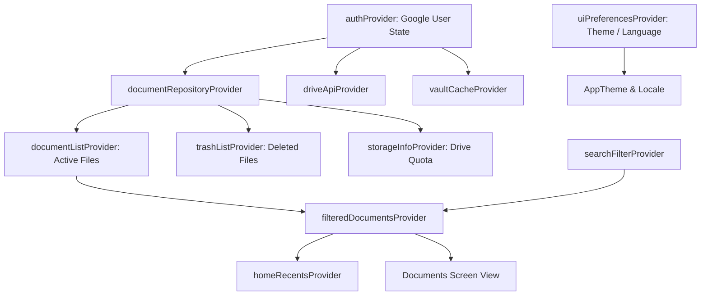

# Vaulty — Technical App Architecture Deep-Dive

This document details the internal architecture, design patterns, state flow, cryptographic safeguards, and native platform integration of **Vaulty**.

---

## 1. Architectural Layers & Structure

Vaulty follows clean, modular architectural boundaries:

```
lib/
├── app/                  # Application composition, routing (GoRouter), live bootstrap
├── core/
│   ├── l10n/             # Internationalization engine (AppStrings, hi.dart, en)
│   ├── theme/            # Pixel-inspired Material 3 tokens, colors, typography, abstract art
│   ├── utils/            # Formatters (dates, file sizes, mime types)
│   └── widgets/          # Atomic reusable UI components (AppCard, AppButton, NoticeCenter)
├── domain/
│   ├── models/           # Pure domain models (Document, StorageInfo, SearchFilter, AuditEvent)
│   └── repositories/     # Repository interfaces (DocumentRepository, AuthRepository, SearchRepository)
├── data/
│   ├── cache/            # Hardware-backed AES-256-GCM local encrypted cache & envelopes
│   ├── device/           # Native bridges (biometrics, notifications, sharing, file validation)
│   ├── drive/            # Google Drive v3 REST API implementation, OAuth verification, metadata codec
│   └── mock/             # Fixtures and deterministic test scenarios
└── features/
    ├── auth/             # Login, account gate, biometric lock screen
    ├── home/             # Home shell, storage quota card, abstract card banner, recents
    ├── documents/        # Document list/grid, live file preview, metadata details, quick actions
    ├── search/           # Filter chips, instant query matching, advanced search sheet
    ├── upload/           # Intake sheets (camera, gallery, files), document metadata forms
    ├── imports/          # Android SEND share-intent review and batch staging
    ├── settings/         # Appearance, language selector, cache controls, reminders, danger zone
    └── trash/            # Soft-delete management, restore, and 30-day sync purge
```

---

## 2. State Management & Provider Graph

Vaulty utilizes **Riverpod 2.6** for reactive, decoupled, compile-safe dependency injection and state management.



### Key Provider Design Patterns:
- **Scoped User Invalidation**: When the user switches Google accounts or logs out, all downstream family providers are immediately invalidated and purged to prevent cross-account state leakage.
- **Optimistic Updates & Instant Rollbacks**: File metadata edits, tag modifications, and soft-delete actions immediately reflect in the UI layer with an Undo toast capability. If a remote Drive network call fails, the state automatically rolls back to the persistent remote snapshot.

---

## 3. Storage & Google Drive API v3 Protocol

Vaulty interacts with Google Drive's REST API v3 using direct client-side HTTP calls (`lib/data/drive/drive_api.dart`).

### Google Drive Metadata Schema
Documents are stored with canonical metadata mapped directly to Google Drive properties:

```json
{
  "name": "Passport_Front.pdf",
  "mimeType": "application/pdf",
  "parents": ["appDataFolder"],
  "properties": {
    "vaulty_owner": "Aditya Chaudhari",
    "vaulty_tags": "travel,id,passport",
    "vaulty_kind": "pdf",
    "vaulty_uploaded_at": "2026-10-15T10:00:00.000Z",
    "vaulty_renewal_date": "2028-05-15",
    "vaulty_deleted_at": null
  }
}
```

### Resumable Chunked Upload Protocol
For files up to 50 MB:
1. Initiate session with `POST https://www.googleapis.com/upload/drive/v3/files?uploadType=resumable`.
2. Stream binary payload in 256 KB aligned chunks with `Content-Range` headers.
3. Handle transient network drops through exponential backoff retry.

---

## 4. Hardware-Backed Cryptographic Engine

Vaulty employs authenticated encryption (**AES-256-GCM**) for all files cached on the local Android filesystem.

### Encryption Pipeline:
1. **Master Key Generation**: A 256-bit AES master key is generated via the hardware-backed `AndroidKeyStore` provider.
2. **Encrypted Envelope**: When a document is downloaded for preview or offline reading:
   - A unique 96-bit Initialization Vector (IV) is generated per file.
   - The document payload is encrypted using AES-GCM.
   - The resulting payload, 128-bit authentication tag, and cryptographic metadata are saved inside the application's private internal storage (`/data/user/0/in.teamparadox.vaulty/cache/`).
3. **Decryption on Demand**: When opening in an external app, a transient decrypted copy is created strictly inside the private `FileProvider` directory and marked for deletion upon app pause.

---

## 5. Native Platform Bridge (`MainActivity.kt`)

The Android host communicates with Flutter via dedicated `MethodChannel` and `EventChannel` pipelines:

1. **Native PDF Preview Rendering**:
   - `android.graphics.pdf.PdfRenderer` opens the local PDF and rasterizes the first page into an in-memory Bitmap.
   - The bitmap bytes are returned directly to Flutter as a Uint8List, eliminating the need for heavy external viewing plugins.
2. **Share Intent Interception**:
   - `MainActivity.kt` handles `Intent.ACTION_SEND` and `Intent.ACTION_SEND_MULTIPLE`.
   - Content URIs from external apps (WhatsApp, Chrome, Gmail) are opened using Android's `ContentResolver`, verified, copied into temporary sandboxed storage, and dispatched into Flutter's `incomingShareProvider`.
3. **Device Boot & Renewal Alarms**:
   - `BootReceiver.kt` listens to `android.intent.action.BOOT_COMPLETED`.
   - On reboot, the native receiver invokes Flutter's background renewal registration task to re-arm all pending document expiry alarms with Android's `AlarmManager`.

---

## 6. Internationalization & String Interpolation

Vaulty features an in-house, zero-dependency localization engine (`AppStrings` & `hi.dart`) optimized for performance and strict user data privacy.

- **Dynamic Template Matching**:
  Regular expressions dynamically match parameter patterns without sacrificing performance:
  - `{n} documents` -> `{n} दस्तावेज़`
  - `Step {n} of 3` -> `चरण {n}/3`
  - `Due in {n} days` -> `{n} दिनों में देय`
- **Zero-Translation User Data Guard**:
  User-entered content (document titles, custom tags, owner names, Google email addresses) is detected and passed through verbatim without alteration, preserving original identities and document integrity.

