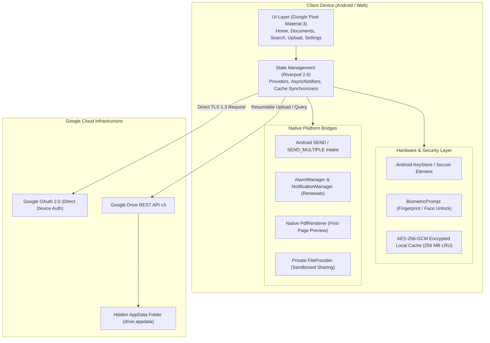

# Vaulty — Comprehensive Project & Engineering Report

**Project Title:** Vaulty — Decentralized Personal Document Vault & Organizer  
**Lead Developer:** Aditya Chaudhari ([aditya.teamparadox.in](https://aditya.teamparadox.in) | [aditya@teamparadox.in](mailto:aditya@teamparadox.in))  
**Organization & Collaboration:** Team Paradox ([teamparadox.in](https://teamparadox.in))  
**Date:** October 15, 2026  
**Version:** 0.3.0+3  
**Platforms:** Android (Target SDK 35, Min SDK 26), Web  

---

## 1. Executive Summary

In today's digital landscape, personal identity documents (passports, insurance policies, national IDs, medical records, financial certificates) are routinely stored in unencrypted camera rolls, generic cloud folders, or messaging apps. Existing commercial document managers often require accounts on proprietary cloud servers, exposing sensitive personal records to third-party data breaches, surveillance, and corporate storage shutdowns.

**Vaulty** solves this fundamental privacy crisis through a **zero-backend, serverless personal document vault**. Vaulty communicates directly and exclusively with the user's personal Google Drive using the restricted `drive.appdata` hidden scope. By pairing client-side Google OAuth 2.0 with hardware-backed **AES-256-GCM** local encryption via Android KeyStore, Google Pixel-inspired Material 3 aesthetics, a robust renewal monitoring engine, and a complete bilingual localization system (English & Formal Hindi), Vaulty delivers an enterprise-grade, high-security personal document vault that guarantees absolute user data sovereignty.

---

## 2. Problem Statement & Design Objectives

### Key Pain Points
1. **Third-Party Surveillance & Cloud Liability**: Traditional solutions require users to upload documents to custom server backends (Firebase, AWS S3 buckets, proprietary microservices).
2. **Accidental Exposure & Cluttered Storage**: Storing documents in general Google Drive folders leads to accidental sharing, public link generation, or clutter in personal drives.
3. **Missing Renewal Lifecycle Tracking**: Important legal documents expire unnoticed due to a lack of proactive local reminders.
4. **Poor Offline Usability & Security**: Apps either store unencrypted copies in external storage or fail completely when disconnected from the internet.
5. **Generic, Unresponsive Interfaces**: Most utility apps lack modern motion design, accessibility scaling, and multi-language support for regional users.

### Architectural Objectives
- **Zero-Backend Guarantee**: No intermediary server, proxy, database, or analytics tracking.
- **App-Data Isolation**: Utilize Google Drive's hidden Application Data space (`drive.appdata`).
- **Hardware-Backed Cryptography**: AES-256-GCM encryption with per-account keys anchored in the Android KeyStore / Secure Element.
- **Biometric Security**: Operating-system level biometric gate guarding app entry and sensitive operations.
- **Pixel-Grade UI & Motion**: Material 3 tonal surfaces, Spring/Overscroll physics, haptic feedback, 48dp touch targets, and 1.3x text scaling compliance.
- **Comprehensive Bilingual Support**: Full formal Hindi localization alongside English, with strict zero-translation guardrails protecting raw user data.

---

## 3. System Architecture & Technical Specifications

### Architectural Highlights:
1. **Direct Google Drive v3 REST Engine**:
   - Resumable chunked uploads for large documents up to 50 MB.
   - Zero intermediate proxy; client requests carry bearer tokens obtained directly from Google Sign-In SDK.
   - Account verification safeguards ensure the active access token strictly matches the signed-in user's identity before executing operations.
2. **Hardware-Backed Local Cache**:
   - 256 MB LRU budget per account.
   - Binary envelopes encrypt document bytes with AES-256-GCM.
   - Integrity verified via 128-bit authentication tags, preventing on-device tampering.
3. **Intent Intake Engine**:
   - Direct handling of Android `SEND` and `SEND_MULTIPLE` intents.
   - Staging incoming shared files in encrypted temporary sandbox before explicit user review and commit.
4. **Renewal & Background Scheduler**:
   - Renewal reminders scheduled through Android's `AlarmManager` with exact alarms.
   - `BOOT_COMPLETED` receiver automatically reschedules active document renewals upon device reboot.

---

## 4. Key Feature Matrix

| Feature | Implementation | Security & UX Impact |
| :--- | :--- | :--- |
| **Authentication** | Google Sign-In (OAuth 2.0) | Direct authorization; no passwords stored on device. |
| **Document Storage** | Google Drive `appDataFolder` | Private, hidden, immune to accidental deletions in standard Drive UI. |
| **Local Cache** | AES-256-GCM + Android KeyStore | High-speed offline access with hardware-anchored encryption at rest. |
| **App Security** | Biometric Screen Lock | Fingerprint, Face, and Device PIN gate with auto-lock on backgrounding. |
| **Document Intake** | Multi-source (Files, Camera, Gallery, OS Share) | Supports PDF, JPEG, PNG, WebP, GIF, HEIC/HEIF, DOCX up to 50 MB. |
| **Preview Engine** | Native Android `PdfRenderer` + Image Provider | Secure in-memory first-page PDF preview without external viewers. |
| **Renewal Engine** | Local `AlarmManager` + Periodic Check | Timely expiration nudges with 30-day, 7-day, and due-date alerts. |
| **Trash & Purge** | Logical Trash + 30-day Retention | Soft-delete with instant Undo; automated purge after 30 days on sync. |
| **Export & Backup** | In-memory ZIP archive generation | 150 MB export of files and canonical metadata for total data portability. |
| **Localization** | Dual Language Pack (English & Formal Hindi) | 190+ formal keys; user document titles and tags preserved verbatim. |

---

## 5. Security & Threat Modeling

1. **Compromised Device Physical Access**:
   - Biometric screen lock prevents unauthorized app opening.
   - Files stored in app sandbox are encrypted with KeyStore-backed keys inaccessible to unauthorized apps on non-rooted devices.
2. **Network Interception (MITM)**:
   - All network traffic is strictly TLS 1.3 encrypted directly to Google endpoints (`*.googleapis.com`).
   - App does not connect to any insecure HTTP endpoints or third-party hosts.
3. **External File Sharing Security**:
   - External sharing generates temporary files within a dedicated Android `FileProvider` path with read-only grants (`FLAG_GRANT_READ_URI_PERMISSION`).
   - Temporary decrypted files are purged automatically upon sharing lifecycle completion.

---

## 6. Verification, Testing & Quality Assurance

### Test Suite Summary
- **Unit & Widget Tests**: 58 automated tests spanning:
  - Account switching and credential isolation
  - Navigation resets and private search clearing
  - Multi-density accessibility rendering (320dp screen width, 1.3x text scale)
  - Dark and Light Material 3 theme compliance
  - Logical Trash soft-delete, restore, and guarded purge
  - Network error handling with exponential backoff & single-endpoint retry
  - Formal Hindi localization keys, parameter interpolation (`{n}`, `{date}`, `{sort}`), and English pass-through
- **Static Code Analysis**: `flutter analyze` passes with **0 warnings and 0 errors**.
- **Physical Device Validation**:
  - Validated on **Redmi Note 8 (Android 15, API 35)**.
  - Confirmed 60fps smooth scrolling, bouncy transitions, toast timeout/swipe dismissal, native PDF preview generation, and full Hindi translation rendering across all screens.

---

## 7. Project Ownership, Credits & Collaboration

Vaulty is designed and engineered by:
- **Lead Developer**: **Aditya Chaudhari**
  - Website: [aditya.teamparadox.in](https://aditya.teamparadox.in)
  - Email: [aditya@teamparadox.in](mailto:aditya@teamparadox.in)
- **Collaborating Organization**: **Team Paradox**
  - Website: [teamparadox.in](https://teamparadox.in)

Licensed under the **MIT License**.

